# Notes version 3: the Spud Notes look, light and dark, 19 October 2026

Branch `notes-v3`, cut from `main` at `d162f14`. Not merged. Product owner ruling of 19 October 2026, recorded as `CLAUDE.md` section 9c. Files changed: `notes/index.html`, `CLAUDE.md`, `PROJECT_HANDOFF.md`, `forecast-app/tests/test_notes_page.py`, `notes-tests/site.test.js`, plus new `notes-tests/theme.test.js` and `docs/evidence/` files. Nothing else on the site and nothing in Assay changed.

## What ran

- `npm ci`, then `npm test`: **70 before, 78 after, 78 pass.** The eight new tests are `notes-tests/theme.test.js`.
- `python -m unittest discover -s tests` from `forecast-app/`: **318 before, 332 after, all pass.** The container had no `fastapi`, so `pip install -r requirements.txt` ran first; three modules errored on import until then, on `main` too.
- Browser runs, Chromium 1194 through Playwright, the real page and the real API handlers over an in-memory store: `browser-check.mjs` **38 of 38**, `browser-check-v2.mjs` **25 of 25**, `browser-check-signout.mjs` **26 of 26**, all unchanged in what they check, so notes behaviour is unchanged.
- New `docs/evidence/notes-page/browser-check-v3.mjs`: **66 of 66.** At 320px and 1280px, light and dark: the theme switch label matches the page and shows on sign in, the ground is the right colour, no sideways scroll on sign in, list or edit, the long title is cut with an ellipsis, each row bin has an aria-label starting "Delete note: " and a 44px square hit area, search shows the matching line, the confirm button is the only red-bordered element, the note box is still monospace, sign out leaves the theme alone, a reload keeps dark. Also: a device in dark mode with no saved choice gets the dark page and the sun icon; the first press goes light and saves it; with `localStorage` throwing the switch still works and the page logs no error; a saved dark choice is on the html element by `DOMContentLoaded`.

## Contrast, computed by the test from the declared values

Ratios to one decimal place of rounding. Every pair in the brief is at least 4.5:1. Nothing was changed to make one pass.

| Pair | On ground | On panel | On hover |
|---|---|---|---|
| light ink | 12.94 | 11.76 | 11.25 |
| light strong | 16.56 | 15.05 | 14.41 |
| light muted | 5.76 | 5.23 | 5.01 |
| light bad | 6.71 | 6.10 | 5.84 |
| dark ink | 11.68 | 12.68 | 10.33 |
| dark strong | 13.87 | 15.05 | 12.26 |
| dark muted | 5.44 | 5.91 | 4.81 |
| dark bad | 6.14 | 6.67 | 5.43 |

On accent: `--notes-on-accent` is 5.52:1 in both themes. The tightest pair is dark `--notes-muted` on `--notes-hover`, 4.81:1.

## Controls proved able to fail

Each change was made to `notes/index.html`, the Python notes tests run, and the file restored. All fifteen failed at least one test: a raw hex colour outside the theme blocks, a px font size outside `:root`, the two dark blocks differing by one digit, the light muted colour set to the retired `#77716e`, an undeclared variable, a box shadow, a 4px radius, a 2px border, uppercase text, Archivo on the h1, a seventh icon, the row aria-label losing its prefix, an unwrapped `localStorage` write, the retired grey as the icon colour, a 3px outline. `test_the_contrast_check_can_fail` also pins the contrast function to 21:1 for black on white and shows `#77716e` on the hover colour is below 4.5. In the Node suite, a copy of the switch script with its save removed is shown not to save.

## Existing checks that held `/notes` to the old rules or the old markup

Reported rather than quietly edited. The ruling of 19 October 2026 wins for `/notes`.

1. `notes-tests/site.test.js`, "the page uses only tokens: no raw colour and no hand-written type size". It demanded zero radius, no hex colour and the site's `--text-*` size tokens. Replaced with a check that every font size is one of the six `--notes-size-*` variables, plus the dash rule. Colour, shape and contrast moved to the Python tests.
2. `forecast-app/tests/test_notes_page.py`, the site-rule style checks (raw colour and size, declared variables, zero radius, `test_archivo_everywhere_but_the_note_box`). Rewritten as the brief listed. The monospace check keeps its rule under the new name `test_monospace_only_in_the_note_box`; `CLAUDE.md` section 9b names it and was updated to match. The node-suite, root-page and dash tests are unchanged.
3. `docs/evidence/notes-page/browser-check-v2.mjs`, two selectors for the confirm button, `getByRole('button', { name: 'Delete note' })`. Now `exact: true`, because the row bin's new label "Delete note: Shopping" also contains that text and Playwright refused the ambiguous match. No behaviour changed.

## Choices the brief left open, for the product owner to overturn

- **Sizes live in the same `:root` block as the light colours**, as the brief said. So "every variable in the light block is also in dark" is held for the 15 colour variables; the six size variables are page constants, not themed.
- **The row bin is one path** (lid, handle, body and both inner lines in a single `d`), where the brief listed them as separate parts. The drawing is the same.
- **The icons are six `<symbol>` shapes in one hidden sprite**, used with `<use>`, so each shape is defined exactly once.
- **The Enter button on sign in is the orange primary button**, as it was; the brief did not name it.
- **Status detail text** (for example the conflict message under the toolbar) stays muted at 13px. The brief puts the state in the dot and word only.
- **`:root[data-theme="light"] { color-scheme: light; }`** is a fourth, colour-free rule, so that choosing light on a dark device also lights the scrollbar and form controls.

## Vercel Preview check, 19 October 2026

Run by the product owner on the branch Preview, at `6ad8427`, on a phone and on a computer. Reported to the build session, which cannot reach Vercel hosts. **All six steps passed, as reported:** the dark and light switch; the choice surviving a reload; the theme surviving Sign out, with the switch on the sign-in screen; search; the bin confirmation, with Delete note the only red-bordered element and Keep working; the status dots through Not saved, Saving and Saved, with All notes, Copy and Delete; and no sideways scroll at phone width, with long titles ending in an ellipsis. The report did not say which phone or browser was used, so a specific browser is not claimed here. **The six judgement calls above are accepted by the product owner.** Approved to merge.

## Not run

- `npm run test:vercel`: needs the network, blocked in this environment.
- The Vercel Preview: the product owner checks it.
- Safari, Firefox and a real phone. Phone width is a 320px Chromium viewport.

## Screenshots

Taken by `browser-check-v3.mjs` from the real page. File names are `<width>-<theme>-<state>.png`.

### 320px, light

**Sign in**

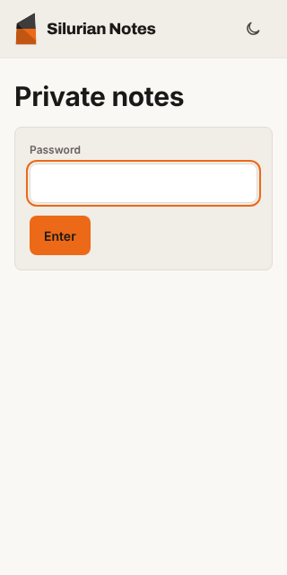

**List**

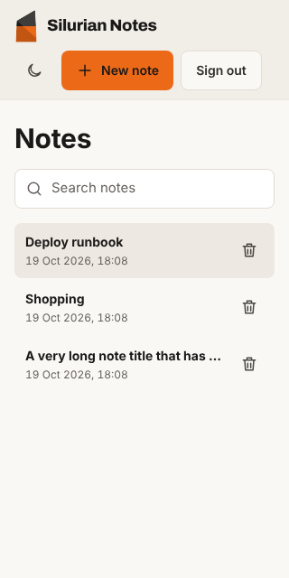

**List, searching for "zephyrine"**

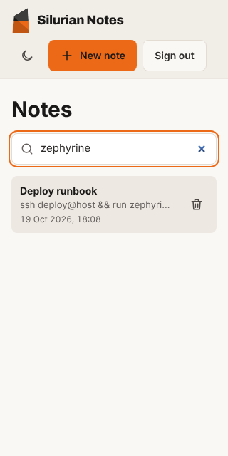

**Row delete confirmation**

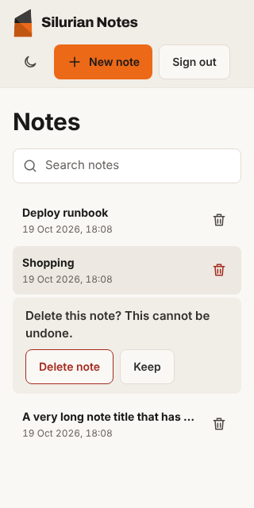

**Edit**

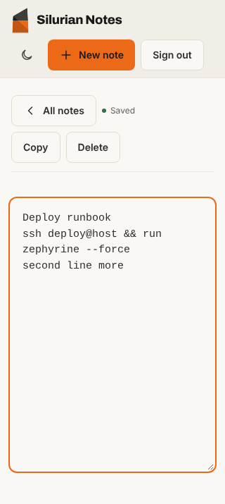

### 320px, dark

**Sign in**

**List**

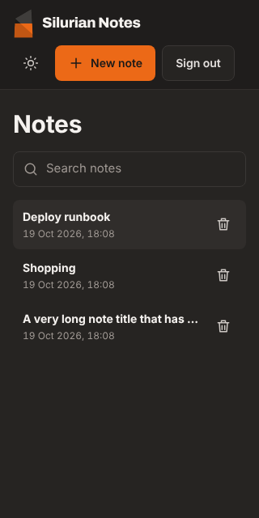

**List, searching for "zephyrine"**

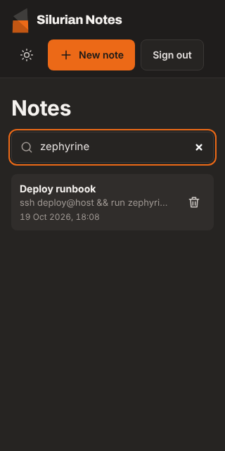

**Row delete confirmation**

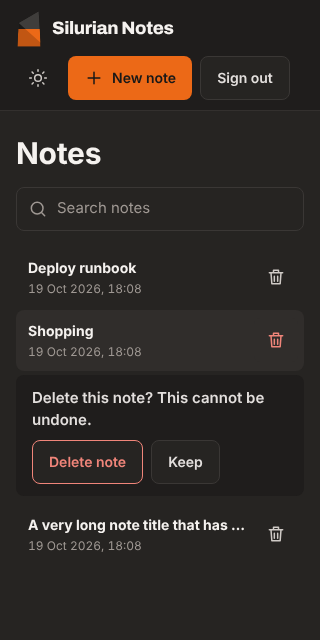

**Edit**

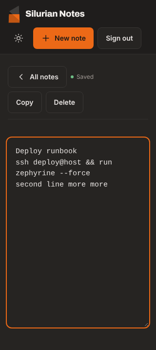

### 1280px, light

**Sign in**

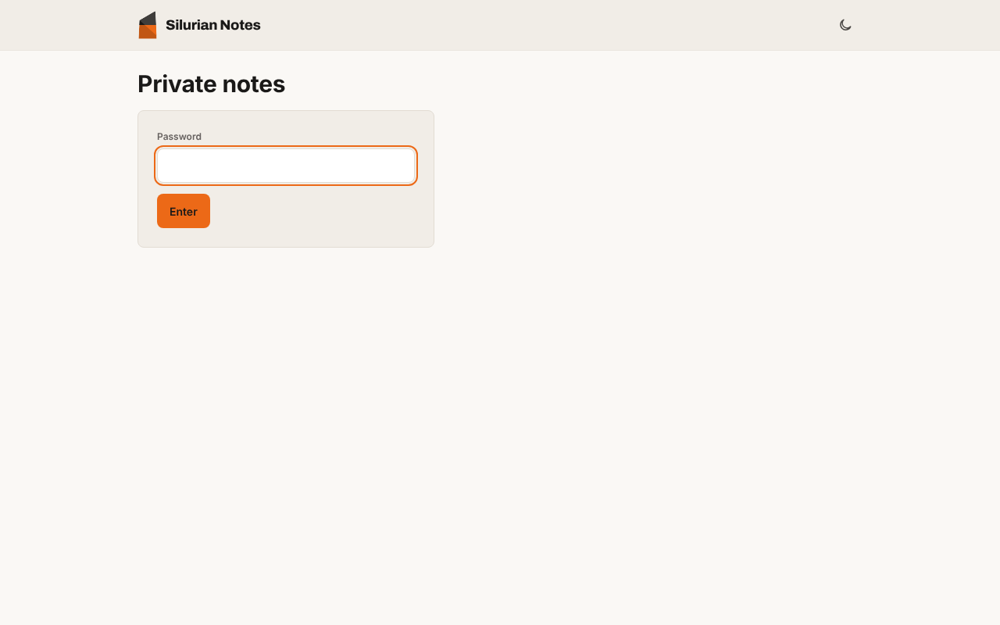

**List**

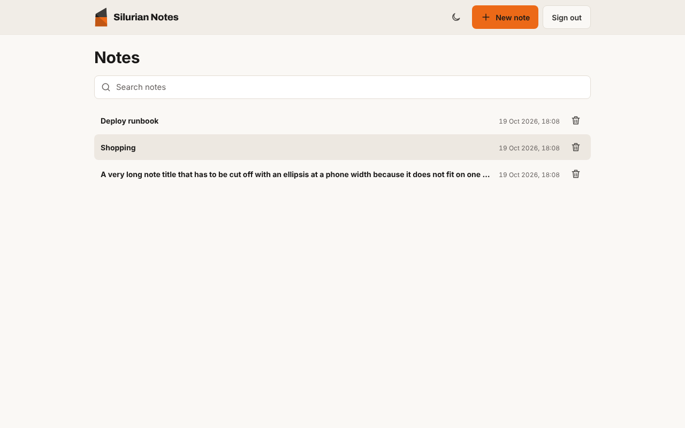

**List, searching for "zephyrine"**

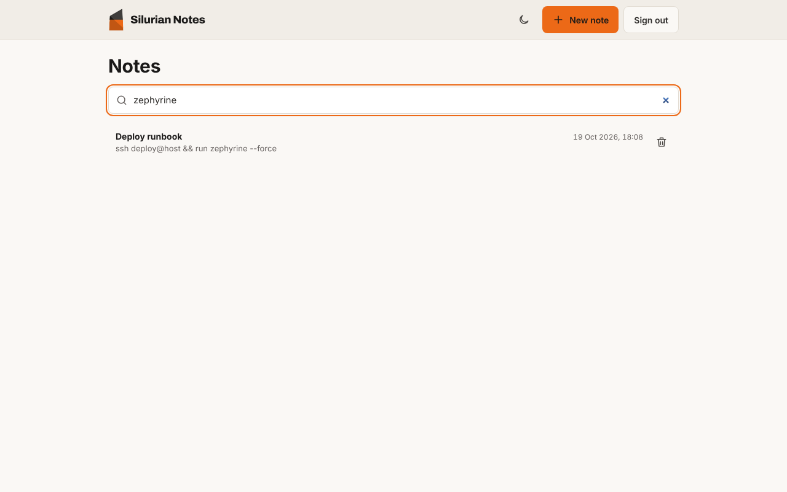

**Row delete confirmation**

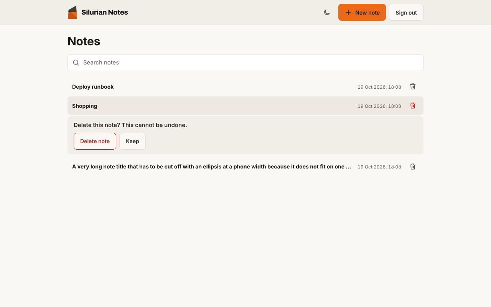

**Edit**

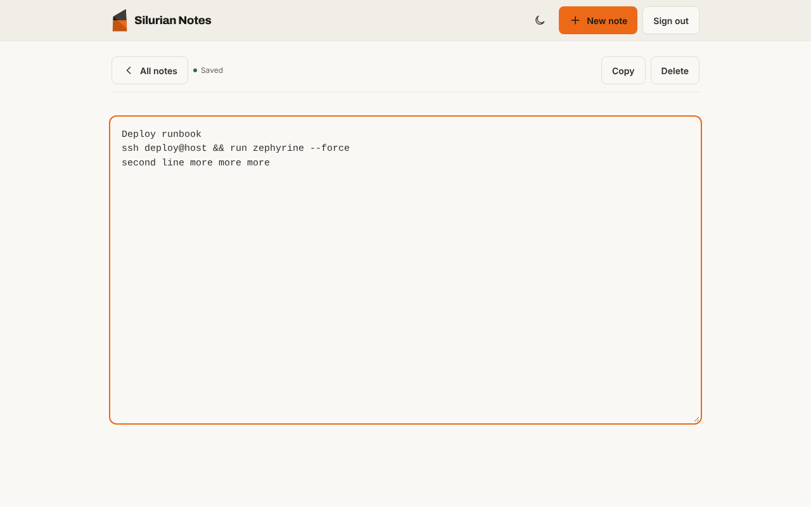

### 1280px, dark

**Sign in**

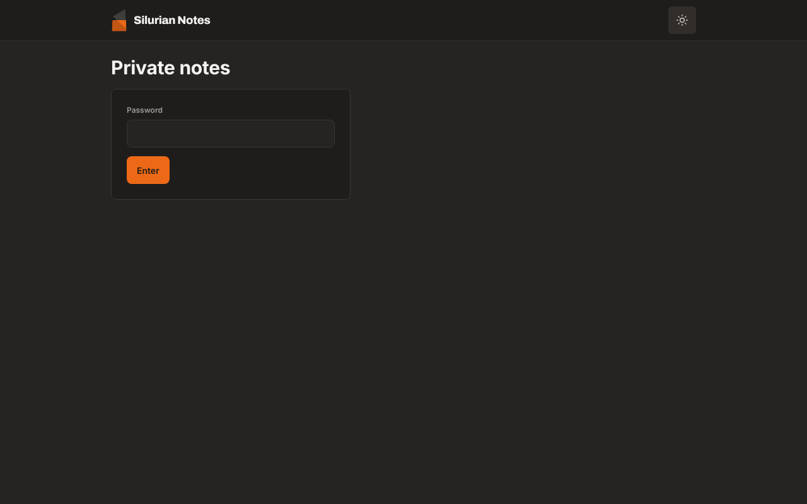

**List**

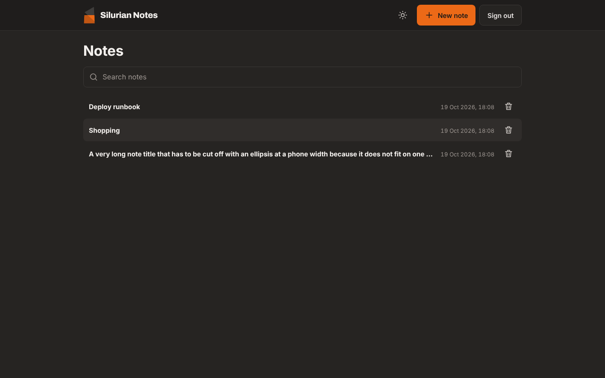

**List, searching for "zephyrine"**

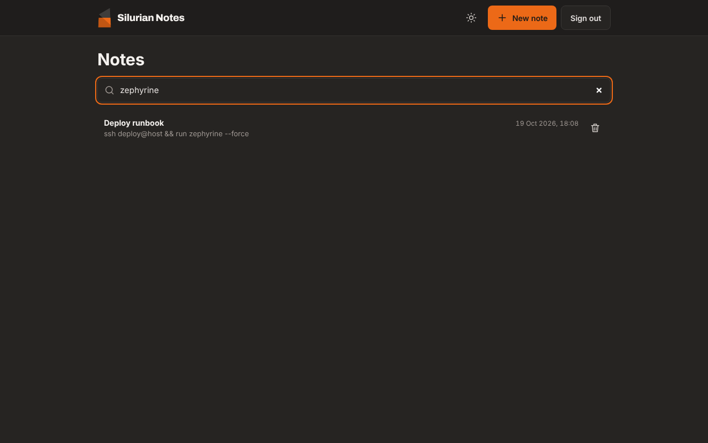

**Row delete confirmation**

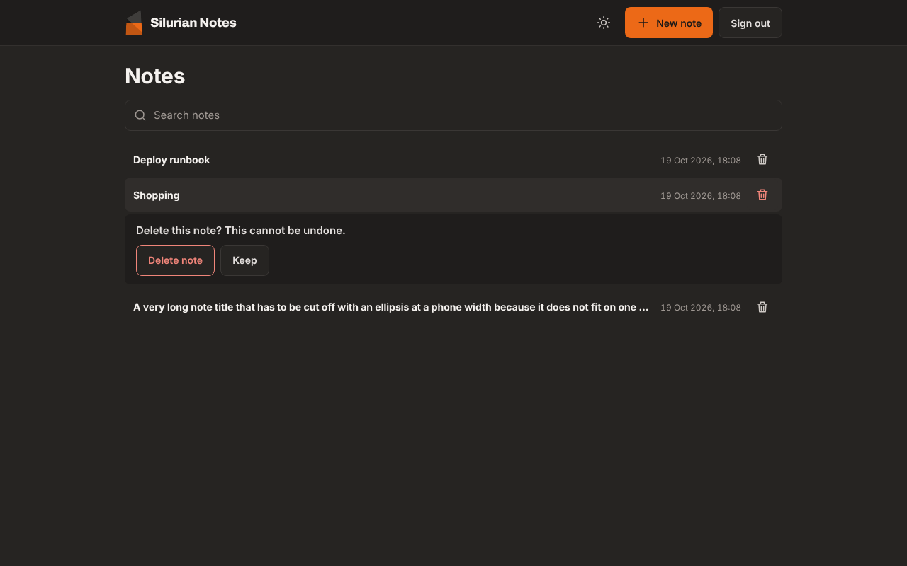

**Edit**

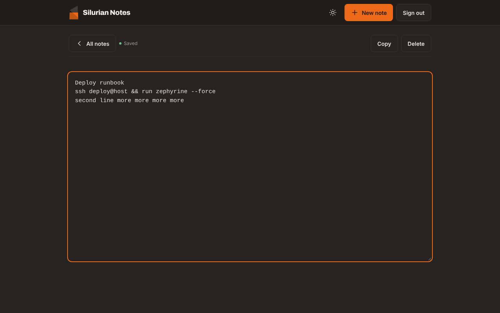

